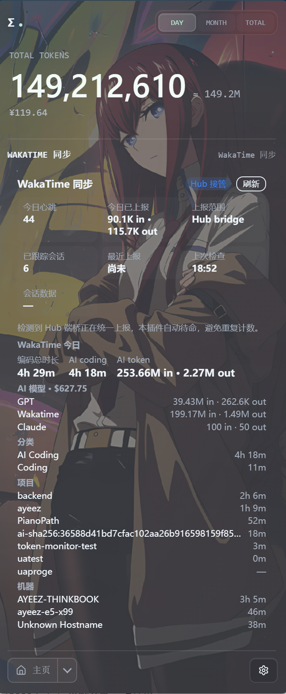

<p align="right"><a href="./README.md">简体中文</a> | <a href="./README.en.md">English</a> | <strong>繁體中文</strong></p>

# Token Monitor 的 WakaTime 同步

把 Token Monitor 的 AI token 用量以 WakaTime 的 **AI Coding** 心跳上報，並在緊湊卡片裡讀回 WakaTime 當天資料。



單機可用，共享 Hub 的多裝置情境也有配套的 Hub 橋（本倉庫 `hub-bridge/`）。

> 非官方社区集成，与 WakaTime 官方及 Token Monitor 维护者无关。

## 它做什么

Token Monitor 按 AI 工作階段統計 50+ 种编程工具的 token，WakaTime 按编辑器檔案統計时间。
外掛每轮只上報增量，调用 `POST /api/v1/users/current/heartbeats.bulk`：

| Token Monitor | WakaTime 心跳 |
| --- | --- |
| 客户端（`codex`、`dsh`、`claude`…） | `entity: token-monitor:<client>` |
| 分類 | `ai coding`（可配置） |
| 工作階段 | `ai_session` |
| input + 快取读/写增量 | `ai_input_tokens` |
| output 增量 | `ai_output_tokens` |
| 專案名或工作区檔案夹 | `project` |
| 设备主机名 / 时区 | `X-Machine-Name` / `Timezone` 请求头 |
| 外掛版本 | User-Agent `token-monitor/<version>` |

之后 WakaTime 的 AI Coding 時長与 AI token 計數会和手工编码并排出现。
AI **模型**歸屬交给 WakaTime 自己的 CLI 解析器：我们试过往 UA 塞自定义模型，会被当成虛構模型并推算出成本，所以不再发送。

## 相容性

- Token Monitor：`>=0.82.0`（外掛 API `tmApi: 1`，实验性）。构建与验证基于 0.87.x。
- 外掛 UI：Windows 11（Token Monitor 桌面端）。其他桌面平台使用同一套宿主 API，但未在此环境验证。
- Hub 桥：Node 22.15+，Linux/macOS（与 Token Monitor hub 使用同一 Node）。

## 安裝

1. 从 [Releases](https://github.com/Ayeez757/wakatime-sync/releases) 下载最新的 `wakatime-sync-<版本>.tmplugin`。
2. Token Monitor → 設定 → 外掛 → 匯入该檔案（或本目錄）→ 阅读可信代码警告 → **信任并安裝启用**。
3. 在外掛設定里填入 <https://wakatime.com/api-key> 的外掛专用 key（唯寫）。
4. 打开「向 WakaTime 发送心跳」，首次启用时同意**背景执行**，Token Monitor 运行期间就会持续上報。
5. 可选：填入 <https://wakatime.com/oauth> 的个人 OAuth token，卡片才会显示 WakaTime 統計。API key 只能写不能读。

建议先打开「試執行」，確認心跳载荷后再正式发送。

## 按情境選擇

| 情境 | 設定 |
| --- | --- |
| 单机本地採集 | `scope: auto`、`category: ai coding`、计入快取 token |
| 多设备共享 Hub 且 Hub 上跑着桥 | 保持「检测到 Hub 桥时由 Hub 上報」開啟：外掛每輪詢问桥并待命，由 Hub 统一上報所有设备 |
| 多设备但没有 Hub 桥 | 每台機器都开外掛，`scope: auto` 只上報本机工作階段 |
| 只看板、不上報 | 關閉上報，只填 OAuth token |
| WakaTime 已经在记 AI coding | WakaTime 的 CLI 預設会解析 Claude/Codex/Copilot/DeepSeek/Cursor 轉錄。若已覆盖你的工作階段，请关掉本外掛上報（只留卡片），否则会重複計數 |

同一个帳號/機器只保留一个上報方：本外掛、Hub 桥、WakaTime 自带 AI sync 三选一。

## 設定项

| 設定 | 預設 | 作用 |
| --- | --- | --- |
| 向 WakaTime 发送心跳 | 关 | 上報总开关 |
| WakaTime API key | — | 心跳用的唯寫 key |
| WakaTime OAuth access token | — | 卡片读統計 |
| 上報哪些工作階段 | auto | 用 Hub 设备列表定位本机；多设备 Hub 上匹配不到本机时**直接暂停上報**，绝不误传其他设备；`aggregate` 才上報全 Hub |
| WakaTime 分類 | ai coding | 选 `coding` 会并入手工编码，也可选其他分類 |
| 计入快取 token | 开 | 把快取读/写计入 `ai_input_tokens` |
| 專案名来源 | label | Token Monitor 專案名 / 工作区檔案夹名 / 不上報 |
| 專案名前缀 | — | 可选，例如 `ai-` |
| 上報间隔 | 60 秒 | 30–900 秒，修改后无需重新加载外掛 |
| 检测到 Hub 桥时由 Hub 上報 | 开 | 桥在 17322 端口應答时本外掛待命 |
| Hub 桥地址 | 自动 | 留空 = 与 Hub 同主机 + 17322 端口 |
| 試執行 | 关 | 只記錄不发送 |

## 計數行为

- 首轮只記錄基準，不会一次性补发当天历史。
- 跨天或計數回退时重建基準，不发负数。
- 基準用「客户端 + 设备 + 工作階段开始时间」做 key，App 重启后不会因不透明行 id 变化而丢增量。
- 每轮每个工作階段一条心跳；多模型合并计算，同一批心跳使用不同的亚秒时间。
- 工作階段資料不可用时如实显示，绝不当作 0；分页被截斷时显示 `(partial)`。

## 卡片

上報状态、今日心跳、已上報 input/output token、上報範圍、已跟踪工作階段、最近上報、上次检查、工作階段資料可用性；
以及 WakaTime 当天：编码总時長、AI Coding 時長、AI token、AI 模型（含成本）、分類、專案、機器。
「重新整理」会强制輪詢并重读統計（統計快取 30 秒）。

## Hub 桥（多设备）

`hub-bridge/` 是无头 Node 进程：读 Hub 的 `/api/stats`，为所有设备发送同样的心跳，并暴露 presence 介面
（`POST /presence/plugin`、`GET /presence`）供桌面外掛协调。说明见 [hub-bridge/README.md](hub-bridge/README.md)。

## 資料与访问

- 外掛属于可信代码，拥有本机用户的檔案与網路權限，不做沙箱隔离。
- 只向 WakaTime 与配置的 Hub 发送 token 計數、工作階段 id、專案名、機器名、时区。
- 不会发送 prompt、对话内容、檔案路径、帳號邮箱或供应商凭证。
- API key、OAuth token、Hub 共享金鑰从 Token Monitor 設定讀取；基準（`state.json`，權限 0600）与外掛偏好（明文 JSON，非加密保险库）保存在外掛資料目錄。
- 桥的配置与基準預設放在 `~/.config/wakatime-bridge/`，權限 0600。

## 更新

发布在 [GitHub Releases](https://github.com/Ayeez757/wakatime-sync/releases)，通过 設定 → 外掛 替换包即可。
仓库根目錄的 `catalog.json` 可作为 HTTPS catalog：在 設定 → 外掛 → 发现 → 更多 → 自定义 catalog 源 里添加
`https://raw.githubusercontent.com/Ayeez757/wakatime-sync/main/catalog.json` 可在应用内发现更新。
回滚只恢复代码，不回滚外掛資料。

## 开发

```sh
npm run check     # 语法、manifest、金鑰扫描
npm test          # 单元测试（不联网）
npm run build     # 生成 dist/<id>-<版本>.tmplugin（需要 TM_REPO 指向 token-monitor 检出）
npm run catalog   # 用构建产物重新整理 catalog.json
```

真實 WakaTime 校验是可选的：`WAKATIME_OAUTH_TOKEN=... npm test` 才会跑 statusbar 解析测试。

## 授權條款与致谢

MIT。外掛 API 与打包器来自 [Token Monitor](https://github.com/Javis603/token-monitor)；WakaTime 是独立服务。图标为本仓库原创。
